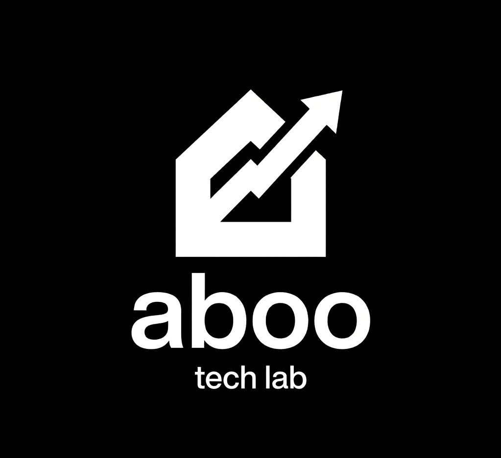

# Aboo Tech Labs — Портфолио  



Это стильный, вдохновлённый дизайном Apple, персональный сайт‑портфолио, демонстрирующий работу **AI‑инженера и разработчика** Абылая. На сайте реализованы:

- **Премиальные meta‑теги OpenGraph и Twitter Card** – красивые превью при отправке ссылки в Telegram, Instagram, WhatsApp и других мессенджерах.  
- **Уникальные UI‑элементы** – бесконечный бегущий marquee с эффектом Spotlight, macOS‑стильный AI‑плейграунд, стеклянные модальные окна, микрорушения.  
- Два проекта‑карточки: **Livesport** (Sports & Streaming) и **AbooPay** (Fintech Salary Calculator).  
- Адаптивный layout, построенный на TailwindCSS и чистом JavaScript.

## Пример работы

После включения GitHub Pages ссылка будет доступна здесь:

```
https://abo-art.github.io/AbooTechLabs/
```

## Как запустить локально

1. **Склонировать репозиторий**  

   ```bash
   git clone https://github.com/abo-art/AbooTechLabs.git
   cd AbooTechLabs
   ```

2. **Открыть сайт** – достаточно открыть `index.html` в браузере (не требуется сборка).  

   ```bash
   open index.html   # macOS
   ```

3. **(Опционально) Сгенерировать картинку превью OpenGraph**  

   ```bash
   python3 gen_og_image.py   # создаст assets/og-preview.png
   ```

## Структура проекта

```
AbooTechLabs/
├─ assets/               # изображения, иконки, слайды, OG‑превью
│   ├─ logo.jpg
│   ├─ og-preview.png
│   ├─ aboopay/          # assets проекта AbooPay
│   └─ livesport/        # assets проекта Livesport
├─ index.html            # основной сайт (генерируется из gen_portfolio.py)
├─ gen_portfolio.py      # скрипт, формирующий HTML
├─ gen_og_image.py       # скрипт, создающий картинку превью
└─ README.md             # ← вы читаете этот файл
```

## Деплой на GitHub Pages

1. Откройте репозиторий → **Settings → Pages**.  
2. В разделе **Source** выберите ветку `main` и папку `/` (корень).  
3. Сохраните. Через несколько минут сайт будет опубликован по адресу  
   `https://abo-art.github.io/AbooTechLabs/`.

Благодаря добавленным meta‑тегам, при копировании этой ссылки в любой мессенджер будет отображаться красивая карточка с изображением `og-preview.png`.

## Вклад в проект

Если хотите улучшить дизайн, анимацию или добавить новые функции – форкните репозиторий и отправьте pull‑request. Пожалуйста, сохраняйте фирменный стиль (чёрный фон, акцент Apple‑Blue `#2997FF`).

## Лицензия

Проект распространяется под лицензией **MIT**. См. файл `LICENSE` для деталей.

---

*Создано с ❤️ Абылаем (Aboo Tech Labs)*
